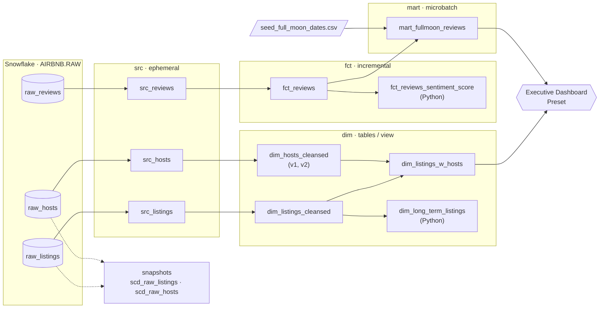

# Airbnb Analytics Pipeline with dbt + Snowflake

An end-to-end ELT pipeline that turns raw Airbnb data from Berlin (17k listings, 14k hosts, 410k guest reviews) into tested, documented and versioned analytics tables in Snowflake, built with **dbt Core 1.11**.

The pipeline also answers a slightly unusual question: **do guests write more negative reviews after a full moon night?** The data says no. 56.9% of reviews written the day after a full moon are positive, against 56.8% on every other day.

This README is a **build log**: it walks through every step taken to build the project, from an empty Snowflake account to a production deployment, with the actual code used at each step.

---

## Contents

- [The pipeline at a glance](#the-pipeline-at-a-glance)
- [Step 1: Environment setup](#step-1-environment-setup)
- [Step 2: Staging models (src)](#step-2-staging-models-src)
- [Step 3: Dimension models (dim)](#step-3-dimension-models-dim)
- [Step 4: Incremental fact model (fct)](#step-4-incremental-fact-model-fct)
- [Step 5: Sources, seeds and freshness](#step-5-sources-seeds-and-freshness)
- [Step 6: Mart model](#step-6-mart-model)
- [Step 7: Snapshots (SCD Type 2)](#step-7-snapshots-scd-type-2)
- [Step 8: Testing](#step-8-testing)
- [Step 9: Jinja, macros and packages](#step-9-jinja-macros-and-packages)
- [Step 10: Documentation](#step-10-documentation)
- [Step 11: Analyses, dashboard and exposures](#step-11-analyses-dashboard-and-exposures)
- [Step 12: dbt-expectations](#step-12-dbt-expectations)
- [Step 13: Logging and debugging](#step-13-logging-and-debugging)
- [Step 14: Tags and selectors](#step-14-tags-and-selectors)
- [Step 15: Python models](#step-15-python-models)
- [Step 16: Variables and orchestration-ready backfills](#step-16-variables-and-orchestration-ready-backfills)
- [Step 17: Microbatching](#step-17-microbatching)
- [Step 18: Model lifecycle: versioning, deprecating, disabling](#step-18-model-lifecycle-versioning-deprecating-disabling)
- [Step 19: Targets, environment variables and custom schemas](#step-19-targets-environment-variables-and-custom-schemas)
- [Results](#results)
- [Project structure](#project-structure)
- [Quick start](#quick-start)
- [Notes from the build](#notes-from-the-build)
- [Not covered yet](#not-covered-yet)

---

## The pipeline at a glance



In one sentence: raw CSVs are loaded into Snowflake, dbt renames and cleans them, joins listings with their hosts, loads reviews incrementally, scores their sentiment in Python, tags each review by whether it was written the day after a full moon, and feeds the results to a BI dashboard. Every step is covered by tests.

**Tech stack:** Snowflake · dbt Core 1.11 + `dbt-snowflake` · SQL + Jinja · Python models on Snowpark · `dbt_utils` · `dbt_expectations` · Preset (Superset) · `uv` for the Python environment

---

## Step 1: Environment setup

### 1.1 Snowflake: key pair, data import, role and user

dbt connects to Snowflake as a dedicated **service user** that authenticates with an **RSA key pair** instead of a password. The key pair can be generated with OpenSSL:

```bash
openssl genrsa 2048 | openssl pkcs8 -topk8 -v2 des3 -inform PEM -out rsa_key.p8   # private key (encrypted)
openssl rsa -in rsa_key.p8 -pubout -out rsa_key.pub                                 # public key
```

Then a single setup script was run in a Snowflake worksheet as `ACCOUNTADMIN`. It creates the database and imports the raw data from a public S3 bucket:

```sql
CREATE WAREHOUSE IF NOT EXISTS COMPUTE_WH;
CREATE DATABASE AIRBNB;
CREATE SCHEMA IF NOT EXISTS AIRBNB.RAW;
CREATE SCHEMA IF NOT EXISTS AIRBNB.DEV;

USE SCHEMA AIRBNB.RAW;

CREATE OR REPLACE TABLE raw_listings
    (id integer, listing_url string, name string, room_type string,
     minimum_nights integer, host_id integer, price string,
     created_at datetime, updated_at datetime);

COPY INTO raw_listings
    FROM 's3://dbt-datasets/listings.csv'
    FILE_FORMAT = (type = 'CSV' skip_header = 1 FIELD_OPTIONALLY_ENCLOSED_BY = '"');

-- same pattern for raw_reviews (reviews.csv) and raw_hosts (hosts.csv)
```

It also keeps compute costs low:

```sql
ALTER WAREHOUSE COMPUTE_WH SET WAREHOUSE_SIZE = 'XSMALL' AUTO_SUSPEND = 60 AUTO_RESUME = TRUE;
```

And it creates the `TRANSFORM` role and the `dbt` user with the public key:

```sql
CREATE ROLE TRANSFORM;
GRANT ROLE TRANSFORM TO ROLE ACCOUNTADMIN;

CREATE USER IF NOT EXISTS dbt
  LOGIN_NAME = 'dbt'
  TYPE = SERVICE
  RSA_PUBLIC_KEY = '<contents of rsa_key.pub>'
  DEFAULT_ROLE = TRANSFORM
  DEFAULT_WAREHOUSE = 'COMPUTE_WH'
  DEFAULT_NAMESPACE = 'AIRBNB.RAW';

GRANT ROLE TRANSFORM TO USER dbt;
GRANT ALL ON WAREHOUSE COMPUTE_WH TO ROLE TRANSFORM;
GRANT ALL ON DATABASE AIRBNB TO ROLE TRANSFORM;
GRANT ALL ON ALL SCHEMAS IN DATABASE AIRBNB TO ROLE TRANSFORM;
GRANT ALL ON FUTURE SCHEMAS IN DATABASE AIRBNB TO ROLE TRANSFORM;
GRANT ALL ON ALL TABLES IN SCHEMA AIRBNB.RAW TO ROLE TRANSFORM;
GRANT ALL ON FUTURE TABLES IN SCHEMA AIRBNB.RAW TO ROLE TRANSFORM;
```

A separate read-only `REPORTER` role and `PRESET` user were created the same way for the BI tool (Step 11).

Result in `AIRBNB.RAW`:

| Table | Rows | Content |
|---|---:|---|
| `raw_listings` | 17,499 | name, room type, minimum nights, price as a string (`$75.00`), host |
| `raw_hosts` | 14,111 | host name, superhost flag (`t` / `f`) |
| `raw_reviews` | 410,284 | reviews from June 2009 to October 2021, with a pre-labelled sentiment |


### 1.2 Python environment and dbt project

The Python environment is managed with `uv` (`pyproject.toml` pins `dbt-core~=1.11.0` and `dbt-snowflake~=1.11.0`):

```bash
uv sync
.venv\Scripts\activate          # Windows
dbt init --skip-profile-setup airbnb
cd airbnb                       # every dbt command runs from this folder
```

### 1.3 Connection profile

`profiles.yml` tells dbt how to reach Snowflake. It is **git-ignored** because the first version held credentials. Step 19 replaces it with a version that reads everything from environment variables.

```yaml
airbnb:
  outputs:
    dev:
      type: snowflake
      account: <account-identifier>
      user: dbt
      role: TRANSFORM
      private_key_path: <path-to>/rsa_key.p8
      private_key_passphrase: <passphrase>
      database: AIRBNB
      schema: DEV
      threads: 4
      warehouse: COMPUTE_WH
  target: dev
```

```bash
dbt debug    # → "All checks passed!"
```

---

## Step 2: Staging models (src)

The first layer only **renames** raw columns into clear, consistent names, one model per raw table. They started as views, then were switched to **ephemeral** in `dbt_project.yml`, so dbt inlines them as CTEs and no objects are created in Snowflake:

```yaml
# dbt_project.yml
models:
  airbnb:
    +materialized: view      # default for everything
    src:
      +materialized: ephemeral
    dim:
      +materialized: table
    fct:
      +tags: ['fact']
```

`models/src/src_listings.sql`:

```sql
WITH raw_listings AS (
    SELECT * FROM {{ source('airbnb', 'listings') }}
)

SELECT
    id AS listing_id,
    name AS listing_name,
    listing_url,
    room_type,
    minimum_nights,
    host_id,
    price AS price_str,
    created_at,
    updated_at
FROM
    raw_listings
```

`src_hosts.sql` (`id` → `host_id`, `name` → `host_name`) and `src_reviews.sql` (`date` → `review_date`, `comments` → `review_text`, `sentiment` → `review_sentiment`) follow the same pattern.

```bash
dbt run
dbt show -s src_hosts     # preview the output without creating anything
```

---

## Step 3: Dimension models (dim)

Dimensions hold **cleaned** business entities.

`models/dim/dim_listings_cleansed.sql` fixes two data problems: `minimum_nights = 0` becomes `1`, and the text price `"$75.00"` becomes the number `75.00`:

```sql
{{
  config(
    materialized = 'view',
    event_time='created_at'
  )
}}
WITH src_listings AS (
    SELECT * FROM {{ ref('src_listings') }}
)
SELECT
  listing_id,
  listing_name,
  room_type,
  CASE
    WHEN minimum_nights = 0 THEN 1
    ELSE minimum_nights
  END AS minimum_nights,
  host_id,
  REPLACE(price_str, '$') :: NUMBER(10, 2) AS price,
  created_at,
  updated_at
FROM
  src_listings
```

`models/dim/dim_hosts_cleansed.sql` replaces missing host names:

```sql
{{ config(materialized='table') }}

WITH src_hosts AS (
    SELECT * FROM {{ ref('src_hosts') }}
)

SELECT
    host_id,
    NVL(host_name, 'Anonymous') AS host_name,
    is_superhost,
    created_at,
    updated_at
FROM src_hosts
```

`models/dim/dim_listings_w_hosts.sql` joins the two. Its `updated_at` is whichever record changed last:

```sql
WITH l AS (
    SELECT * FROM {{ ref('dim_listings_cleansed') }}
), h AS (
    SELECT * FROM {{ ref('dim_hosts_cleansed', v=2) }}   -- pinned to v2, see Step 18
)

SELECT
    l.listing_id,
    l.listing_name,
    l.room_type,
    l.minimum_nights,
    l.price,
    l.host_id,
    h.host_name,
    h.is_superhost AS host_is_superhost,
    l.created_at,
    GREATEST(l.updated_at, h.updated_at) AS updated_at
FROM l
LEFT JOIN h
    ON (h.host_id = l.host_id)
```

---

## Step 4: Incremental fact model (fct)

`fct_reviews` holds 400k+ rows and only grows, so rebuilding it on every run would be wasteful. As an **incremental** model, each run inserts only reviews newer than the latest one already loaded:

```sql
{{
  config(
    materialized = 'incremental',
    on_schema_change='fail'
  )
}}
WITH src_reviews AS (
  SELECT * FROM {{ ref('src_reviews') }}
)
SELECT * FROM src_reviews
WHERE review_text is not null


  AND review_date > (select max(review_date) from {{ this }})

```

This was tested by inserting a new review into the raw table and re-running. Only that one row was added:

```sql
INSERT INTO AIRBNB.RAW.RAW_REVIEWS
VALUES (3176, CURRENT_TIMESTAMP(), 'Bagus', 'excellent stay!', 'positive');
```

```bash
dbt run                  # incremental: loads only the new row
dbt run --full-refresh   # rebuilds the table from scratch
```

The model was extended later with a surrogate key (Step 9), backfill variables (Step 16) and an `event_time` (Step 17).

---

## Step 5: Sources, seeds and freshness

**Sources.** Hard-coded names such as `AIRBNB.RAW.RAW_LISTINGS` were replaced with `{{ source(...) }}`. That gives dbt lineage back to the raw tables, and lets tests and freshness checks run on them. From `models/sources.yml`:

```yaml
sources:
  - name: airbnb
    schema: raw
    tables:
      - name: listings
        identifier: raw_listings
      - name: hosts
        identifier: raw_hosts
      - name: reviews
        identifier: raw_reviews
        config:
          loaded_at_field: date
          freshness:
            warn_after: {count: 1, period: hour}
            error_after: {count: 24, period: hour}
```

```bash
dbt source freshness
```

**Seeds.** `seeds/seed_full_moon_dates.csv` holds 272 full moon dates (2009–2030). Small, static reference data like this lives in the repo as a CSV and is loaded with:

```bash
dbt seed
```

---

## Step 6: Mart model

`models/mart/mart_fullmoon_reviews.sql` is the analysis-ready table. A review is labelled `full moon` if it was written **the day after** a full moon, meaning the guest spent the full moon night at the listing:

```sql
WITH fct_reviews AS (
    SELECT * FROM {{ ref('fct_reviews') }}
),
full_moon_dates AS (
    SELECT * FROM {{ ref('seed_full_moon_dates') }}
)

SELECT
    r.*,
    CASE
        WHEN fm.full_moon_date IS NULL THEN 'not full moon'
        ELSE 'full moon'
    END AS is_full_moon
FROM fct_reviews r
LEFT JOIN full_moon_dates fm
    ON TO_DATE(r.review_date) = DATEADD(DAY, 1, fm.full_moon_date)
```

It started as a plain `table`. Step 17 turns it into a microbatch model, and Step 19 gives it its own schema.

---

## Step 7: Snapshots (SCD Type 2)

Raw listings and hosts change over time (prices, names), and a plain table would overwrite the old values. **Snapshots** keep the full history: each change adds a new row, and the old row is closed with `dbt_valid_to`.

`snapshots/raw_listings_snapshot.yml`:

```yaml
snapshots:
  - name: scd_raw_listings
    relation: source('airbnb', 'listings')
    config:
      unique_key: id
      strategy: timestamp
      updated_at: updated_at
      hard_deletes: invalidate   # rows deleted at the source get closed out
```

`scd_raw_hosts` (`snapshots/raw_hosts_snapshot.yml`) is the same, over `source('airbnb', 'hosts')`.

Tested by changing a listing and snapshotting again:

```sql
UPDATE AIRBNB.RAW.RAW_LISTINGS
SET minimum_nights = 30, updated_at = CURRENT_TIMESTAMP()
WHERE id = 3176;
```

```bash
dbt snapshot
```

```sql
SELECT * FROM AIRBNB.DEV.SCD_RAW_LISTINGS WHERE id = 3176;   -- two rows: old and new
```

---

## Step 8: Testing

### Generic tests: `models/schema.yml`

```yaml
models:
  - name: dim_listings_cleansed
    description: membersihkan tabel yang berisi data listing airbnb
    columns:
     - name: listing_id
       data_tests:
         - unique
         - not_null

     - name: host_id
       data_tests:
         - not_null
         - relationships:
             arguments:
               to: ref('dim_hosts_cleansed')
               field: host_id

     - name: room_type
       data_tests:
         - accepted_values:
             arguments:
               values: ['Entire home/apt', 'Private room', 'Shared room', 'Hotel room']

     - name: minimum_nights
       data_tests:
         - positive_values          # custom generic test, see below
```

`dim_hosts_cleansed` gets `not_null` + `unique` on `host_id`, `not_null` on `host_name` and `accepted_values: ['t', 'f']` on `is_superhost`.

### Storing failures

Every failing test writes its failing rows to a table, so they can be inspected with SQL:

```yaml
# dbt_project.yml
data_tests:
  +store_failures: true
  +schema: _test_failures
```

### Singular tests

A singular test is a SQL query that should return **zero rows**.

`tests/dim_listings_minimum_nights.sql`:

```sql
SELECT * FROM {{ ref('dim_listings_cleansed') }}
WHERE minimum_nights < 1
LIMIT 10
```

`tests/consistent_created_at.sql` checks that no review is dated before its listing was created:

```sql
SELECT * FROM {{ ref('dim_listings_cleansed') }} l
INNER JOIN {{ ref('fct_reviews') }} r
USING (listing_id)
WHERE l.created_at > r.review_date
```

### Custom generic tests

Reusable tests that take parameters. `tests/generic/positive_values.sql`:

```sql

SELECT * FROM {{ model }} WHERE {{ column_name }} <= 0

```

`tests/generic/minimum_row_count.sql` defaults to `warn`, and `schema.yml` raises it to `error` for `dim_listings_cleansed`:

```sql

{{ config(severity='warn') }}

SELECT COUNT(*) AS cnt
FROM {{ model }}
HAVING COUNT(*) < {{ min_row_count }}

```

```yaml
  - name: dim_listings_cleansed
    data_tests:
      - minimum_row_count:
          arguments:
            min_row_count: 1000
            severity: error
```

### Unit tests

Data tests check the data; **unit tests check the logic** using hand-written input rows. `models/mart/unit_tests.yml` checks that only the day *after* a full moon is matched:

```yaml
unit_tests:
  - name: unittest_fullmoon_matcher
    model: mart_fullmoon_reviews
    given:
      - input: ref('fct_reviews')
        rows:
          - {review_date: '2025-01-13'}
          - {review_date: '2025-01-14'}
          - {review_date: '2025-01-15'}
      - input: ref('seed_full_moon_dates')
        rows:
          - {full_moon_date: '2025-01-14'}
    expect:
      rows:
        - {review_date: '2025-01-13', is_full_moon: "not full moon"}
        - {review_date: '2025-01-14', is_full_moon: "not full moon"}
        - {review_date: '2025-01-15', is_full_moon: "full moon"}
```

```bash
dbt test                                 # all tests
dbt test -s dim_listings_minimum_nights  # one test
dbt test -s mart_fullmoon_reviews        # tests attached to one model
dbt test -s "test_type:unit"             # unit tests only
dbt build                                # run + test everything in dependency order
```

---

## Step 9: Jinja, macros and packages

### Macros

`macros/select_positive_values.sql` is a reusable SQL snippet:

```sql

    select *
    from {{ model }}
    where {{ column_name }} > 0

```

`macros/no_empty_strings.sql` asks the database for a table's columns and builds a filter for every string column:

```sql

    
        
            {{ col.name }} IS NOT NULL AND {{ col.name }} <> '' AND
        
    
    TRUE

```

```bash
dbt compile --inline "{{ select_positive_values('dim_listings_cleansed', 'price') }}"
dbt show --inline "SELECT * FROM {{ ref('dim_listings_cleansed') }} WHERE {{ no_empty_strings(ref('dim_listings_cleansed')) }}"
```

### Packages

`packages.yml`:

```yaml
packages:
  - package: dbt-labs/dbt_utils
    version: 1.3.3
  - package: metaplane/dbt_expectations
    version: 0.10.10
```

```bash
dbt deps
```

`dbt_utils.generate_surrogate_key` gives every review a stable unique ID in `fct_reviews`:

```sql
SELECT
  {{ dbt_utils.generate_surrogate_key(['listing_id', 'review_date', 'reviewer_name', 'review_text']) }} AS review_id,
  *
FROM src_reviews
```

---

## Step 10: Documentation

Descriptions are added in `schema.yml`. Longer text goes in reusable **doc blocks**, in `models/docs.md`:

```

Minimum number of nights required to rent this property.

Keep in mind that old listings might have `minimum_nights` set
to 0 in the source tables. Our cleansing algorithm updates this to `1`.

```

The doc block is referenced from `schema.yml`:

```yaml
     - name: minimum_nights
       description: '{{ doc("dim_listing_cleansed__minimum_nights") }}'
```

`models/overview.md` replaces the docs site's landing page and shows the input schema image from `assets/` (enabled with `asset-paths: ["assets"]`):

```

# Airbnb pipeline

Hey, welcome to our Airbnb pipeline documentation!

Here is the schema of our input data:


```

```bash
dbt docs generate
dbt docs serve     # browsable site with descriptions and the lineage graph
```

---

## Step 11: Analyses, dashboard and exposures

### Analyses

An **analysis** is a SQL file that dbt compiles (resolving `ref()`) but never materializes. `analyses/full_moon_no_sleep.sql`:

```sql
WITH fullmoon_reviews AS (
    SELECT * FROM {{ ref('mart_fullmoon_reviews') }}
)

SELECT
    is_full_moon,
    review_sentiment,
    COUNT(*) AS reviews
FROM fullmoon_reviews
GROUP BY is_full_moon, review_sentiment
ORDER BY is_full_moon, review_sentiment
```

```bash
dbt compile   # compiled SQL lands in target/compiled/airbnb/analyses/
```

### Dashboard and exposure

An **Executive Dashboard** was built in Preset on top of `dim_listings_w_hosts` and `mart_fullmoon_reviews`, connected to Snowflake through the `PRESET` user. To make dbt aware of it, it is declared as an **exposure** in `models/dashboard.yml`. It then appears in the lineage graph, so the impact of any model change on the dashboard is visible.

```yaml
exposures:
  - name: executive_dashboard
    label: Executive Dashboard
    type: dashboard
    maturity: low
    url: https://<workspace>.us1a.app.preset.io/superset/dashboard/8/
    description: Executive Dashboard about Airbnb listings and hosts

    depends_on:
      - ref('dim_listings_w_hosts')
      - ref('mart_fullmoon_reviews')

    owner:
      name: Bagus Cipta Pratama
```

---

## Step 12: dbt-expectations

[`dbt_expectations`](https://github.com/metaplane/dbt-expectations) adds Great Expectations-style tests on top of the built-in ones.

On the **source** (`models/sources.yml`):

```yaml
      - name: listings
        identifier: raw_listings
        columns:
          - name: room_type
            data_tests:
              - dbt_expectations.expect_column_distinct_count_to_equal:
                  arguments:
                    value: 4
          - name: price
            data_tests:
              - dbt_expectations.expect_column_values_to_match_regex:
                  arguments:
                    regex: "^\\\\$[0-9][0-9\\\\.]+$"    # e.g. $75.00
```

On **`dim_listings_w_hosts`** (`models/schema.yml`):

```yaml
  - name: dim_listings_w_hosts
    tests:
      - dbt_expectations.expect_table_row_count_to_equal_other_table:
          compare_model: source('airbnb', 'listings')     # the join must not drop or duplicate rows
    columns:
      - name: price
        tests:
        - dbt_expectations.expect_column_values_to_be_of_type:
            column_type: number
        - dbt_expectations.expect_column_quantile_values_to_be_between:
            quantile: .99
            min_value: 50
            max_value: 500
        - dbt_expectations.expect_column_max_to_be_between:
            max_value: 5000
            config:
              severity: warn
```

The max-price test raises a **warning** on purpose: one listing costs more than $5,000 a night. It is flagged rather than hidden.

Debugging a failing test means reading its compiled SQL:

```bash
dbt test --select dim_listings_w_hosts
dbt test --select source:airbnb.listings
# then open target/compiled/airbnb/models/schema.yml/<test_name>.sql
```

---

## Step 13: Logging and debugging

**Logging from macros.** `log(..., info=True)` prints to the console. Wrapping it in `{# #}` turns it into a Jinja comment that is never executed. `macros/logging.sql`:

```sql

 {# log("ini contoh komentar kedua!" , info = True) #}

```

```bash
dbt run-operation learn_logging
```

**`--empty`** builds every model with zero rows. This is a fast way to check that the SQL compiles and runs without paying for processing:

```bash
dbt run --empty
```

**`--sample`** builds with only a recent time window of data, using each model's `event_time` (`created_at` on `dim_listings_cleansed`):

```bash
dbt run -s dim_listings_w_hosts --sample "3 days"
```

Other commands used along the way: `dbt parse`, `dbt compile`, `dbt ls`, `dbt clean`, and `dbt run -s 1+dim_listings_w_hosts` (a model plus its direct parents).

---

## Step 14: Tags and selectors

Every model in `fct/` gets the `fact` tag (`dbt_project.yml`, Step 2), and `mart_fullmoon_reviews` is tagged in its config:

```bash
dbt ls -s tag:fact
dbt run -s tag:fact
```

Complex selections are saved in `selectors.yml` for reuse:

```yaml
selectors:
  - name: dim_except_listings_w_hosts
    description: Selects all dim models, excluding dim_listings_w_hosts.
    definition:
      union:
        - method: path
          value: models/dim
        - exclude:
            - method: fqn
              value: dim_listings_w_hosts
```

```bash
dbt run --selector dim_except_listings_w_hosts
```

---

## Step 15: Python models

Some logic is easier in Python. dbt runs Python models **inside Snowflake** on Snowpark, so the data never leaves the warehouse.

`models/dim/dim_long_term_listings.py` uses a Snowpark DataFrame to keep listings that require at least 30 nights:

```python
def model(dbt, session):
    listings = dbt.ref("dim_listings_cleansed")

    return (listings.filter(listings["MINIMUM_NIGHTS"] >= 30)
                   .select("LISTING_ID", "LISTING_NAME", "PRICE"))
```

`models/fct/fct_reviews_sentiment_score.py` uses pandas and the TextBlob NLP library to compute a sentiment score from -1 to +1 for every review:

```python
from textblob import TextBlob


def get_sentiment(text):
    return TextBlob(text).sentiment.polarity


def model(dbt, session):
    dbt.config(
        materialized="table",
        packages=["textblob", "snowflake-connector-python[pandas]"]
    )

    reviews_df = dbt.ref("fct_reviews")
    df = reviews_df.to_pandas()
    df["SENTIMENT_SCORE"] = df["REVIEW_TEXT"].apply(get_sentiment)

    return df
```

`models/dim/dim_fullmoon.py` flags which full moon dates fall on German public holidays, using the `holidays` package. It is disabled in Step 18.

```bash
dbt run -s dim_long_term_listings
dbt run -s fct_reviews_sentiment_score
```

---

## Step 16: Variables and orchestration-ready backfills

**Variables.** A project-level default in `dbt_project.yml`:

```yaml
vars:
  user_name: "Bagus Cipta Pratama"
```

It is read in `macros/variables.sql`:

```sql

      
      {{ log("Hello " ~ your_name_jinja , info = True) }}

      {{ log("Hello dbt user " ~ var("user_name", "NO USERNAME IS SET") ~ "!" , info = True) }}

```

The default can be overridden from the command line:

```bash
dbt run-operation learn_variables
dbt run-operation learn_variables --vars "{user_name: Bagus}"
```

**Backfills.** An orchestrator (Airflow, Dagster, …) needs to reload a specific time window. `fct_reviews` therefore accepts `start_date` / `end_date` variables, and falls back to "everything newer than what's loaded" when they are not set:

```sql

  
    {{ log('Loading ' ~ this ~ ' incrementally (start_date: ' ~ var("start_date") ~ ', end_date: ' ~ var("end_date") ~ ')', info=True) }}
    AND review_date >= '{{ var("start_date") }}'
    AND review_date < '{{ var("end_date") }}'
  
    AND review_date > (select max(review_date) from {{ this }})
    {{ log('Loading ' ~ this ~ ' incrementally (all missing dates)', info=True) }}
  

```

```bash
dbt run --select fct_reviews --vars '{start_date: "2024-02-15 00:00:00", end_date: "2024-03-15 23:59:59"}'
```

---

## Step 17: Microbatching

**Microbatch** is dbt's built-in incremental strategy for time-series data. dbt splits the work into time batches that can run, fail and be retried independently.

`fct_reviews` gets an `event_time`, so downstream models know which column holds the time:

```sql
{{
  config(
    materialized = 'incremental',
    on_schema_change='fail',
    event_time = "review_date"
  )
}}
```

`mart_fullmoon_reviews` becomes a microbatch model with one batch per year since the first review. `full_refresh = False` protects it from accidental rebuilds:

```sql
{{
    config(
        materialized='incremental',
        incremental_strategy='microbatch',
        event_time = "review_date",
        full_refresh = False,
        begin = "2009-06-20",
        batch_size = "year",
        tags=['fact'],
        schema='mart'      -- added in Step 19
    )
}}
```

```sql
SELECT min(review_date), max(review_date) FROM AIRBNB.DEV.FCT_REVIEWS;   -- 2009-06-20 … 2021-10-22
```

```bash
# a full refresh has to be requested explicitly, for a given window
dbt run -s mart_fullmoon_reviews --full-refresh --event-time-start "2020-01-01" --event-time-end "2030-01-01"
```

(`threads: 4` in `profiles.yml` is required here, because microbatching can hang with a single thread.)

---

## Step 18: Model lifecycle: versioning, deprecating, disabling

**Versioning.** Changing the host-name placeholder from `'Anonymous'` to `'N/A'` would break consumers that rely on the old value. Instead of editing the model in place, a **v2** was added next to v1 in `models/dim/dim_hosts_cleansed_v2.sql`:

```sql
{{ config(materialized='table') }}

WITH src_hosts AS (
    SELECT * FROM {{ ref('src_hosts') }}
)

SELECT
    host_id,
    NVL(host_name, 'N/A') AS host_name,
    is_superhost,
    created_at,
    updated_at
FROM src_hosts
```

`models/schema.yml` declares both versions, gives v1 a **deprecation date**, and makes v2 the latest:

```yaml
  - name: dim_hosts_cleansed
    versions:
      - v: 1
        defined_in: dim_hosts_cleansed
        deprecation_date: 2030-01-01
      - v: 2
        columns:
          - include: '*'
            exclude: [host_name]
          - name: host_name
            description: The name of the host (N/A if not available)
            data_type: string
            constraints:
              - type: not_null
    latest_version: 2
```

Both versions are built side by side (`dim_hosts_cleansed_v1`, `dim_hosts_cleansed_v2`), and `dim_listings_w_hosts` is pinned to v2 with `ref('dim_hosts_cleansed', v=2)`.

**Disabling.** `dim_fullmoon.py` is no longer needed, so it is switched off without deleting the code:

```python
    dbt.config(
        materialized="table",
        packages=["holidays", "snowflake-connector-python[pandas]"],
        enabled=False
    )
```

---

## Step 19: Targets, environment variables and custom schemas

### Targets

The project is deployed to separate environments by adding **targets** to the profile, each writing to its own schema:

```bash
dbt build                  # → dev
dbt build --target prod    # → PROD
```

### Environment variables

The production profile lives in `_prod_profiles/profiles.yml`. It contains **no secrets**: every credential is read from an environment variable, which makes it safe for CI/CD. Each developer also gets their own dev schema:

```yaml
airbnb:
  outputs:
    staging:
      type: snowflake
      account: "{{ env_var('SNOWFLAKE_ACCOUNT') }}"
      user: "{{ env_var('DBT_USER') }}"
      role: TRANSFORM
      private_key: "{{ env_var('PRIVATE_KEY') }}"
      private_key_passphrase: "{{ env_var('PRIVATE_KEY_PASSPHRASE') }}"
      database: AIRBNB
      schema: STAGING
      threads: 4
      warehouse: COMPUTE_WH
    prod:
      # same as staging, with schema: PROD
    dev:
      # same as staging, with a personal schema:
      schema: "DBT_{{ env_var('DBT_ENV_NAME') | upper | trim }}"
  target: dev
```

| Target | Schema | Purpose |
|---|---|---|
| `dev` | `DBT_<NAME>` (e.g. `DBT_BAGUS`) | personal sandbox per developer |
| `staging` | `STAGING` | pre-production check |
| `prod` | `PROD` | production |

The variables are set by a local, git-ignored PowerShell script, `set-env.ps1`:

```powershell
$env:SNOWFLAKE_ACCOUNT      = "<account-identifier>"
$env:DBT_USER               = "dbt"
$env:PRIVATE_KEY            = Get-Content -Raw "<path-to>\rsa_key.p8"   # key contents, not the path
$env:PRIVATE_KEY_PASSPHRASE = "<passphrase>"
$env:DBT_ENV_NAME           = "bagus"
$env:DBT_PROFILES_DIR       = "$PSScriptRoot\_prod_profiles"
```

```powershell
. .\set-env.ps1
dbt debug --profiles-dir _prod_profiles
```

### Custom schemas

`mart_fullmoon_reviews` is given `schema='mart'`. By default dbt would name the schema `<target_schema>_mart` in every environment. The custom `macros/generate_schema_name.sql` changes that, so prod gets a clean `MART` schema while dev and staging stay prefixed and isolated:

```sql


  
  

  
    {{ target_schema_cleansed }}
  
    
        {{ custom_schema_name_cleansed }}
    
      {{ target_schema_cleansed }}_{{ custom_schema_name_cleansed }}
    
  

```

| Model | dev (`DBT_BAGUS`) | prod |
|---|---|---|
| `fct_reviews` (no custom schema) | `DBT_BAGUS` | `PROD` |
| `mart_fullmoon_reviews` (`schema='mart'`) | `DBT_BAGUS_MART` | `MART` |

```bash
# dry run of the prod layout (tests excluded, since every table is empty with --empty)
dbt build --target prod --profiles-dir=_prod_profiles --empty --exclude-resource-type test
```

---

## Results

`dbt build --target prod` finishes with **PASS=33, WARN=1, ERROR=0**. The single warning is the intentional max-price warning from Step 12.

| Table | Rows |
|---|---:|
| `dim_listings_w_hosts` | 17,499 |
| `dim_long_term_listings` | 1,349 |
| `fct_reviews` | 409,697 |
| `fct_reviews_sentiment_score` | 409,697 |
| `mart_fullmoon_reviews` | 409,697 |
| `scd_raw_listings` / `scd_raw_hosts` | 17,499 / 14,111 |

`fct_reviews` holds 587 fewer rows than `raw_reviews` because reviews with no text are dropped.

**Does a full moon make guests grumpier?**

| | Reviews | Positive | Neutral | Negative |
|---|---:|---:|---:|---:|
| Day after a full moon | 13,850 | 56.9% | 35.4% | 7.7% |
| Any other day | 395,847 | 56.8% | 36.0% | 7.3% |

The share of negative reviews is only 0.4 percentage points higher after a full moon, which is too small a difference to say the moon affects how guests rate their stay.

Other findings:
- The average TextBlob sentiment score is **+0.31** (mildly positive).
- **Entire home/apt** is the most common listing type (9,890), at a median of **$75/night**. Private rooms have a median of **$35**.

---

## Project structure

```
airbnb/
├── _prod_profiles/
│   └── profiles.yml             # env-var based profile (git-ignored locally)
├── models/
│   ├── sources.yml              # raw sources + source tests + freshness
│   ├── schema.yml               # descriptions, tests, versions
│   ├── dashboard.yml            # exposure: Preset dashboard
│   ├── docs.md · overview.md    # doc blocks + docs landing page
│   ├── src/                     # staging (ephemeral)
│   ├── dim/                     # dimensions (SQL + Python, versioned hosts)
│   ├── fct/                     # incremental facts (SQL + Python)
│   └── mart/                    # microbatch mart + unit test
├── snapshots/                   # SCD Type 2 snapshots
├── seeds/                       # full moon dates
├── tests/
│   ├── generic/                 # custom generic tests
│   └── *.sql                    # singular tests
├── macros/                      # generate_schema_name + helper macros
├── analyses/                    # full_moon_no_sleep.sql
├── assets/                      # images for the docs site
├── selectors.yml
├── packages.yml
└── dbt_project.yml
```

---

## Quick start

```powershell
# 1. Snowflake: run the setup SQL from Step 1.1 in a worksheet
# 2. Python environment
uv sync
.venv\Scripts\activate
cd airbnb
# 3. Credentials (PowerShell, not cmd)
. .\set-env.ps1
# 4. Build
dbt deps
dbt debug
dbt build                  # dev   → DBT_<NAME>
dbt build --target prod    # prod  → PROD / MART
dbt docs generate; dbt docs serve
```

---

## Notes from the build

Problems hit along the way, and how they were solved:

- **The Snowflake trial ran out after 30 days** (`Your account is suspended due to lack of payment method`). Because the whole setup is a single SQL script and all transformations are dbt code, moving to a new account only took re-running the script, changing the account identifier and running `dbt build`.
- **`--empty` plus source tests fails.** With `--empty`, every source returns 0 rows, so `expect_column_distinct_count_to_equal(4)` on `room_type` fails and 18 downstream nodes are skipped. Dry runs therefore use `--exclude-resource-type test`.
- **Environment variables only exist in the shell that set them.** `set-env.ps1` must be dot-sourced (`. .\set-env.ps1`) in PowerShell. It does nothing in `cmd`, which shows up as `Env var required but not provided: 'SNOWFLAKE_ACCOUNT'`.
- **Two targets pointing at the same schema.** At first, `prod` used `schema: DEV`, so a "prod" build silently overwrote dev. Each target now has its own schema.

---

## Not covered yet

Parts of the full dbt workflow not implemented here, which would be the next steps:

- **Hooks and grants**: an `audit_log` table filled by `post-hook`s, and `grants` so the `REPORTER` role can read prod tables
- **Contract enforcement**: v2 of `dim_hosts_cleansed` declares a `not_null` constraint, but it is only enforced once `contract: {enforced: true}` is added
- **Orchestration with Dagster** (`dagster-dbt` is already in `pyproject.toml`)
- **Schema cleanup** macro (`drop_dev_schemas`), **`dbt retry`**, and **state-based runs** (`--state`, `state:modified`, `--defer`)
- **Slim CI / CD** with GitHub Actions

---

*Built while following the [Complete dbt (Data Build Tool) Bootcamp](https://www.udemy.com/course/complete-dbt-data-build-tool-bootcamp-zero-to-hero-learn-dbt/) on Udemy. Built and documented by **Bagus Cipta Pratama**.*
