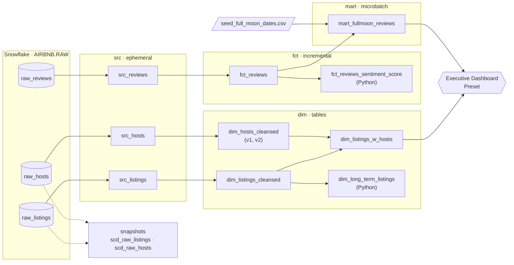
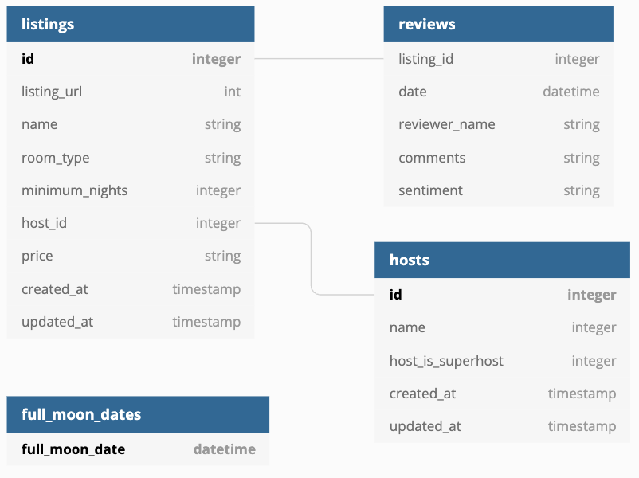

# Airbnb Analytics Pipeline with dbt + Snowflake

An end-to-end ELT pipeline that turns raw Airbnb data (listings, hosts and ~410k guest reviews) into tested, documented and versioned analytics tables in Snowflake, built with **dbt Core**.

The pipeline also answers a slightly unusual question: **do guests write more negative reviews after a full moon night?** The data says no. Sentiment is nearly identical (56.9% vs 56.8% positive).

---

## Contents

1. [The pipeline at a glance](#the-pipeline-at-a-glance)
2. [Source data](#source-data)
3. [How the data flows, layer by layer](#how-the-data-flows-layer-by-layer)
4. [Data quality](#data-quality)
5. [Environments and schema naming](#environments-and-schema-naming)
6. [Results](#results)
7. [Project structure](#project-structure)
8. [Running the project](#running-the-project)
9. [dbt features used](#dbt-features-used)

---

## The pipeline at a glance



In one sentence: raw CSVs are loaded into Snowflake, dbt renames and cleans them, joins listings with their hosts, loads reviews incrementally, tags each review by whether it was written the day after a full moon, and feeds the results to a BI dashboard. Every step is covered by tests.

**Tech stack:** Snowflake · dbt Core 1.11 (`dbt-snowflake`) · SQL + Jinja · Python models on Snowpark · `dbt_utils` · `dbt_expectations` · Preset (Superset)

---

## Source data

The data comes from [Inside Airbnb](https://insideairbnb.com/) (Berlin) and is loaded into the `AIRBNB.RAW` schema in Snowflake:

| Table | Rows | Description |
|---|---:|---|
| `raw_listings` | 17,499 | One row per listing: name, room type, minimum nights, price (as a string like `$75.00`), host |
| `raw_hosts` | 14,111 | One row per host: name, superhost flag |
| `raw_reviews` | 410,284 | One row per review, June 2009 to October 2021, with a pre-labelled sentiment |
| `seed_full_moon_dates` (seed) | 272 | Full moon dates from 2009 to 2030, kept in the repo as a CSV |



---

## How the data flows, layer by layer

### 1. Sources: `models/sources.yml`

The three raw tables are declared as the `airbnb` source, so every model refers to them with `{{ source('airbnb', ...) }}` instead of hard-coded table names. That gives dbt full lineage from the raw tables onward, and lets tests and freshness checks run on the raw data itself.

### 2. Staging (`src_*`): ephemeral

| Model | What it does |
|---|---|
| `src_listings` | Renames columns to clear names (`id` → `listing_id`, `price` → `price_str`) |
| `src_hosts` | `id` → `host_id`, `name` → `host_name` |
| `src_reviews` | `date` → `review_date`, `comments` → `review_text`, `sentiment` → `review_sentiment` |

These are **ephemeral**: dbt inlines them as CTEs in downstream models, so no physical objects are created. They exist only to keep renaming in one place.

### 3. Dimensions (`dim_*`): cleaned business entities

| Model | Materialization | Logic |
|---|---|---|
| `dim_listings_cleansed` | view | Fixes `minimum_nights = 0` → `1`; converts `"$75.00"` → `75.00` as `NUMBER(10,2)` |
| `dim_hosts_cleansed` **v1** | table | Fills missing host names with `'Anonymous'` (deprecated, removal date 2030-01-01) |
| `dim_hosts_cleansed` **v2** | table | Fills missing host names with `'N/A'`, with an enforced `not_null` contract on `host_name` (latest version) |
| `dim_listings_w_hosts` | table | Left-joins listings with hosts (v2); `updated_at` is the later of the two records |
| `dim_long_term_listings` | table (**Python**) | Snowpark DataFrame that keeps listings with `minimum_nights >= 30` (1,349 listings) |

`dim_hosts_cleansed` uses **model versioning**: both versions are built side by side so downstream consumers can migrate from v1 to v2 at their own pace before v1 is removed.

### 4. Facts (`fct_*`): events

**`fct_reviews`** is an **incremental** model. It:
- builds a surrogate key `review_id` from `listing_id`, `review_date`, `reviewer_name` and `review_text` using `dbt_utils.generate_surrogate_key`
- drops reviews with no text (410,284 → 409,697 rows)
- on each run, only loads reviews newer than the latest `review_date` already in the table
- can **backfill** a specific window when `start_date` and `end_date` vars are passed
- fails loudly if the source schema changes (`on_schema_change='fail'`)

**`fct_reviews_sentiment_score`** is a **Python model** running on Snowflake Snowpark. It scores every review text with [TextBlob](https://textblob.readthedocs.io/), giving a polarity from -1 to +1, and adds it as `SENTIMENT_SCORE`.

### 5. Mart: `mart_fullmoon_reviews`

The analysis-ready table. It joins every review with the full moon seed and labels it `full moon` if it was written **the day after** a full moon (the night the guest would have slept badly), otherwise `not full moon`.

It uses the **microbatch** incremental strategy: data is processed in yearly batches from 2009-06-20, using `review_date` as the event time. `full_refresh = False` protects it from being rebuilt by accident. A **unit test** checks the "day after full moon" matching logic with three hand-written rows.

### 6. Snapshots: history of changing records

`scd_raw_listings` and `scd_raw_hosts` capture **Slowly Changing Dimension Type 2** history of the raw tables using the `timestamp` strategy on `updated_at`. When a host changes their name or a listing changes its price, the old row is kept with `dbt_valid_to` filled in, and records deleted at the source are closed out (`hard_deletes: invalidate`).

### 7. Consumption

- **Analysis:** `analyses/full_moon_no_sleep.sql` counts reviews by full-moon flag and sentiment.
- **Exposure:** `models/dashboard.yml` registers the **Executive Dashboard** in Preset as a downstream consumer of `dim_listings_w_hosts` and `mart_fullmoon_reviews`, so it shows up in the lineage graph.
- **Docs:** `dbt docs generate` produces a browsable site with model descriptions, column docs (including a reusable `` block for `minimum_nights`) and the input schema image.

---

## Data quality

Tests run as part of `dbt build`, so a model only feeds the next layer once its tests pass. All test failures are stored in Snowflake (`store_failures: true`) for easy debugging.

| Level | Tests |
|---|---|
| **Source** | `room_type` has exactly 4 distinct values; `price` matches the regex `^\$[0-9][0-9\.]+$` (`dbt_expectations`); freshness thresholds on `reviews` |
| **Built-in generic** | `unique`, `not_null`, `accepted_values` (room types, superhost `t`/`f`), `relationships` (every listing's `host_id` exists in hosts) |
| **Custom generic** | `positive_values` (column must be > 0); `minimum_row_count` (table must have at least N rows) |
| **Singular** | No listing has `minimum_nights < 1`; no review is dated before its listing was created |
| **dbt_expectations** | `dim_listings_w_hosts` has the same row count as the source; `price` is numeric; 99th-percentile price is between 50 and 500; max price ≤ 5000 (warning only) |
| **Contract** | `dim_hosts_cleansed` v2 enforces `host_name` as a non-null string at build time |
| **Unit test** | `unittest_fullmoon_matcher` verifies the full-moon matching logic |

> Note: the max-price test intentionally raises a **warning**: one listing is priced above $5,000. It is flagged, not hidden.

---

## Environments and schema naming

Three targets are defined, and all credentials come from environment variables, so no secrets live in the repo:

| Target | Schema | Purpose |
|---|---|---|
| `dev` | `DBT_<YOUR_NAME>` (from `DBT_ENV_NAME`) | Personal sandbox for each developer |
| `staging` | `STAGING` | Pre-production check |
| `prod` | `PROD` | Production |

A custom `generate_schema_name` macro controls where models with a custom schema land. For example, `mart_fullmoon_reviews` (custom schema `mart`):
- in **prod**, it goes to a clean `MART` schema
- in **dev/staging**, it is prefixed, e.g. `DBT_BAGUS_MART`, so developers never overwrite each other or production

---

## Results

Output of the `prod` build:

| Table | Rows |
|---|---:|
| `dim_listings_w_hosts` | 17,499 |
| `dim_long_term_listings` | 1,349 |
| `fct_reviews` | 409,697 |
| `fct_reviews_sentiment_score` | 409,697 |
| `mart_fullmoon_reviews` | 409,697 |

**Does a full moon make guests grumpier?**

| | Reviews | Positive | Neutral | Negative |
|---|---:|---:|---:|---:|
| Day after a full moon | 13,850 | 56.9% | 35.4% | 7.7% |
| Any other day | 395,847 | 56.8% | 36.0% | 7.3% |

The share of negative reviews is only 0.4 percentage points higher after a full moon, which is too small a difference to say the moon affects how guests rate their stay.

Other findings:
- Average TextBlob sentiment across all reviews is **+0.31** (mildly positive).
- **Entire home/apt** is the most common listing type (9,890), with a median price of **$75/night**; private rooms have a median of **$35**.

---

## Project structure

```
airbnb/
├── models/
│   ├── sources.yml              # raw source declarations + source tests
│   ├── schema.yml               # model docs, tests, versions, contracts
│   ├── dashboard.yml            # exposure: Preset executive dashboard
│   ├── docs.md / overview.md    # doc blocks for the docs site
│   ├── src/                     # staging layer (ephemeral)
│   ├── dim/                     # dimensions (SQL + Python)
│   ├── fct/                     # incremental facts (SQL + Python)
│   └── mart/                    # microbatch mart + unit tests
├── snapshots/                   # SCD Type 2 snapshots (YAML)
├── seeds/                       # full moon dates CSV
├── tests/
│   ├── generic/                 # custom generic tests
│   └── *.sql                    # singular tests
├── macros/                      # generate_schema_name + helper macros
├── analyses/                    # ad-hoc analysis queries
├── assets/                      # images for the docs site
├── selectors.yml                # reusable node selection
├── packages.yml                 # dbt_utils, dbt_expectations
└── dbt_project.yml
```

---

## Running the project

### Prerequisites
- Python 3.10+ and `dbt-snowflake` (`pip install dbt-snowflake`)
- A Snowflake account with the `AIRBNB` database, a `RAW` schema holding the three raw tables, and a `TRANSFORM` role
- A user that authenticates with an RSA key pair

### 1. Configure the profile

Create a `profiles.yml` (it is git-ignored) in your profiles directory:

```yaml
airbnb:
  target: dev
  outputs:
    dev:
      type: snowflake
      account: "{{ env_var('SNOWFLAKE_ACCOUNT') }}"
      user: "{{ env_var('DBT_USER') }}"
      role: TRANSFORM
      private_key: "{{ env_var('PRIVATE_KEY') }}"
      private_key_passphrase: "{{ env_var('PRIVATE_KEY_PASSPHRASE') }}"
      database: AIRBNB
      schema: "DBT_{{ env_var('DBT_ENV_NAME') | upper | trim }}"
      warehouse: COMPUTE_WH
      threads: 4
    # staging / prod are identical except for `schema`: STAGING / PROD
```

### 2. Set the environment variables (PowerShell)

```powershell
$env:SNOWFLAKE_ACCOUNT      = "<your-account-identifier>"
$env:DBT_USER               = "dbt"
$env:PRIVATE_KEY            = Get-Content -Raw "<path-to>\rsa_key.p8"
$env:PRIVATE_KEY_PASSPHRASE = "<your-passphrase>"
$env:DBT_ENV_NAME           = "<your-name>"
```

### 3. Build

```bash
dbt deps                              # install dbt_utils and dbt_expectations
dbt debug                             # check the connection
dbt build                             # seeds, snapshots, models and tests, in dependency order
dbt build --target prod               # build into production
```

### Useful commands

```bash
# Backfill a window of reviews into the incremental fact table
dbt run --select fct_reviews --vars '{start_date: "2020-01-01", end_date: "2020-02-01"}'

# Dry run: check that every model compiles and builds, without processing data
dbt build --empty --exclude-resource-type test

# Only the fact models
dbt build --select tag:fact

# All dimensions except dim_listings_w_hosts (selector)
dbt build --selector dim_except_listings_w_hosts

# Check how fresh the raw reviews are
dbt source freshness

# Generate and browse the documentation site
dbt docs generate && dbt docs serve
```

---

## dbt features used

| Area | Features |
|---|---|
| Modeling | sources, `ref`, layered architecture (src → dim/fct → mart), ephemeral / view / table / incremental materializations |
| Incremental | `is_incremental()`, backfill with `var()`, `on_schema_change`, **microbatch** strategy with `event_time` |
| Python | Snowpark Python models (TextBlob sentiment, DataFrame filtering) |
| History | snapshots (SCD Type 2, timestamp strategy, hard-delete handling) |
| Governance | **model versions** with deprecation dates, **model contracts**, exposures |
| Testing | generic, custom generic, singular, unit tests, `dbt_expectations`, `store_failures`, severity levels, source freshness |
| Jinja and macros | custom `generate_schema_name`, reusable macros, `log()`, project `vars` |
| Operations | multiple targets, env-var credentials, selectors, tags, `--empty` dry runs, seeds |
| Documentation | descriptions, `` blocks, `__overview__` page, assets |

---

*Built while following the [Complete dbt (Data Build Tool) Bootcamp](https://www.udemy.com/course/complete-dbt-data-build-tool-bootcamp-zero-to-hero-learn-dbt/) on Udemy. Built and documented by **Bagus Cipta Pratama**.*
